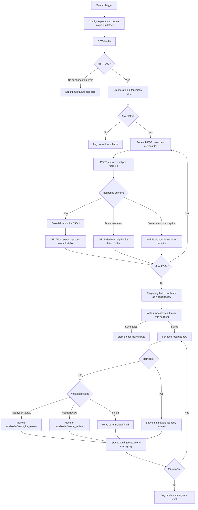
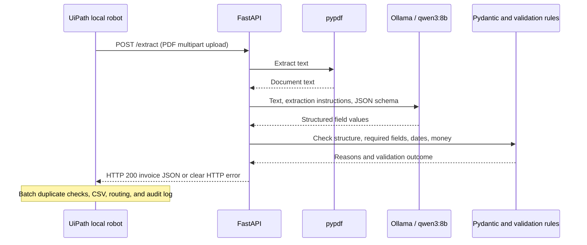

# UiPath invoice workflow diagram

Follow [the step-by-step walkthrough](UiPath_Walkthrough.md). This diagram is the
workflow to build, not a claim that Main.xaml already implements it.

Edit in **Studio Web** and debug **On local machine** through the installed
UiPath Assistant/Robot. Studio Desktop is optional. Cloud execution cannot use
this computer's localhost API and file paths directly.



Move exceptions leave the source available and are logged as routing failures.
The first version does not guarantee crash-safe exactly-once processing; add a
durable identity/result ledger before completing the repeat-run milestone.

## What happens inside the API



## If Mermaid does not render

In VS Code, open this file and use **Open Preview** (Ctrl+Shift+V on Windows).
If your Markdown preview does not support Mermaid, use this plain-text outline:

```text
Manual trigger
  Configure paths
  Health check -> stop if unavailable
  Enumerate PDFs -> finish if empty
  For each PDF
    Try: upload -> read response -> add result row
    Catch: add failure row and leave for retry
  Flag batch duplicates
  Save CSV -> stop before moves if save fails
  For each result
    Retryable -> leave in input
    Otherwise -> move to ready / review / failed
    Log routing outcome
  Finish
```
